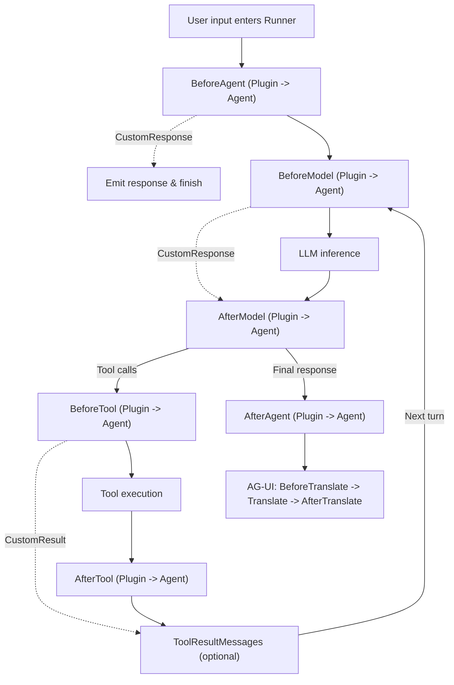
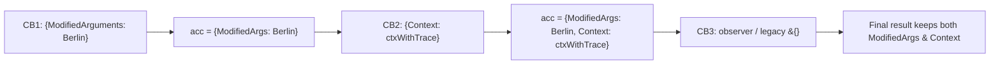

# Callbacks

An agent run moves through a small set of recurring boundaries: entering and
leaving an agent, calling an LLM, executing tools, and (when using AG-UI)
translating events. Production applications often need cross-cutting behavior at
these boundaries—logging, tracing, auth, rate limiting, caching, argument
normalization, or guardrails—without modifying the core flow or wrapping every
model and tool individually.

Callbacks provide declarative `Before` and `After` hooks at these boundaries.
The framework keeps control of streaming channels, concurrent tool execution,
panic recovery, and telemetry; each callback simply inspects the inputs and
returns what it wants to adjust, replace, or stop.

For context replacement, cancellation propagation, and the AfterTool lifecycle,
see [Cancellation and context propagation](cancellation.md).

!!! note "Callbacks vs. Plugins"
    - **Callbacks** are attached to a specific agent (for example via
      `llmagent.WithAgentCallbacks`, `WithModelCallbacks`, or
      `WithToolCallbacks`).
    - **Plugins** bundle callbacks and register them once on a `Runner` via
      `runner.WithPlugins(...)` so they apply globally. At each hook point,
      plugin callbacks run **before** agent-local callbacks. See
      [Plugins](./plugin.md).

---

## How Callbacks Work

### Lifecycle



Dashed arrows show short-circuit paths when a `Before*` callback returns a
non-nil `CustomResponse` or `CustomResult`; if `AfterTool` sets
`SkipSummarization: true`, the turn ends after the tool response instead of
looping back to `BeforeModel`.

### What a Callback Returns

Every structured callback (`Before/After` × `Agent/Model/Tool`) returns
`(result, error)` to express one of four outcomes:

| Outcome | Return Value | Default Chain Behavior |
| --- | --- | --- |
| **Pass through (observe only)** | `nil, nil` (or empty `&Result{}`) | Continue to the next callback |
| **Update context or inputs** | Non-nil `Context`, `ModifiedArguments`, or in-place edits to `args.Request` | Continue and carry the changes forward |
| **Short-circuit or replace output** | Non-nil `CustomResponse` or `CustomResult` | Stop the chain immediately (unless `WithContinueOnResponse(true)`) |
| **Fail or halt the agent** | `err` or `agent.NewStopError(...)` | Stop the chain immediately (unless `WithContinueOnError(true)`) |

---

## Chaining Multiple Callbacks

All **six structured callback chains** (`BeforeAgent`, `AfterAgent`,
`BeforeModel`, `AfterModel`, `BeforeTool`, and `AfterTool`) share the same
execution-control options and result-merging behavior.

!!! note "TranslateCallbacks is separate"
    `TranslateCallbacks` (AG-UI event translation) does not merge results across
    callbacks and has no `WithContinueOn*` options—it stops on the first error
    or non-nil custom event. See [TranslateCallbacks](#translatecallbacks).

### Execution Control

Callbacks run in registration order. By default, a chain stops immediately when
a callback returns an **error** or a non-nil
**`CustomResponse`/`CustomResult`**. Setting only `Context`,
`ModifiedArguments`, or `SkipSummarization` does not stop the chain.

`agent.NewCallbacks`, `model.NewCallbacks`, and `tool.NewCallbacks` all accept
the same two options:

```go
callbacks := model.NewCallbacks(
    model.WithContinueOnError(true),    // Keep running on errors; return the first error at the end.
    model.WithContinueOnResponse(true), // Keep running on CustomResponse/CustomResult; latest override wins.
)
```

| Mode | `ContinueOnError` | `ContinueOnResponse` | Behavior |
| --- | --- | --- | --- |
| **Default** | `false` | `false` | Stop on the first error or first `CustomResponse`/`CustomResult`. |
| **Continue on Error** | `true` | `false` | Keep running on errors (preserving the **first** error); still stop on `CustomResponse`/`CustomResult`. |
| **Continue on Response** | `false` | `true` | Keep running on overrides (using the **last** non-nil override); still stop on error. |
| **Continue on Both** | `true` | `true` | Run all callbacks; return the merged result alongside the first error (if any). |

When a single callback returns both an error and a custom response/result, error
handling runs first (stopping immediately when `continueOnError == false`).

### How Results Merge Across Callbacks

In real applications, a callback chain usually combines independent concerns—for
example, one callback injects tracing or deadline context, another rewrites tool
arguments, and a third logs and returns nothing. Because these callbacks do not
know about each other, an unset field in a later result means *"leave this
alone"*, not *"clear what an earlier callback set"*.

Unless execution stops on a callback error, the framework treats each non-nil
result as a read-only update and merges it into an accumulator. Returning `nil`,
an empty `&Result{}`, or a legacy `(nil, nil)` callback never wipes out earlier
fields:



Different fields carry different semantics, so merging follows three rules:

| Field Group | Fields | Merge Rule & Reason |
| --- | --- | --- |
| **Independent pipeline state** | `Context` (all 6 chains)<br>`ModifiedArguments` (`BeforeTool`) | **Latest non-nil wins** and is forwarded to subsequent callbacks (`ctx` / `args.Arguments`). Each callback can layer onto the previous context or arguments without knowing what other callbacks changed. Derive replacement contexts from the input `ctx` to preserve cancellation, deadlines, and values; `context.Background()` or `context.WithoutCancel(ctx)` deliberately detaches cancellation. |
| **Result + handling flags** | `CustomResponse` (`Agent`/`Model`)<br>`CustomResult` + `SkipStateDelta` (`BeforeTool`)<br>`CustomResult` + `SkipResultFormatter` + `SkipStateDelta` (`AfterTool`) | **Replaced together as a unit** only when a later callback returns a non-nil `CustomResponse` or `CustomResult`. Flags like `SkipStateDelta` and `SkipResultFormatter` describe how to handle that specific `CustomResult`, so they must stay paired with it—under `WithContinueOnResponse(true)`, an empty pass-through keeps the earlier bundle intact, while a new `CustomResult` replaces both the result and its flags. |
| **Turn-ending signal** | `SkipSummarization` (`AfterTool`) | **Logical OR** across callbacks (including on early `CustomResult` stop). Once a callback decides the tool output should end the turn without another LLM call, a later observer that omits the flag should not undo that decision. |

See [Behavioral Details & Edge Cases](#behavioral-details-edge-cases) for
struct ownership isolation, error-stop return values, and parallel tool
publication.

---

## Callback Types

Each callback type follows the control and merging rules above. The sections
below focus on the stage-specific types, fields, and agent wiring.

### AgentCallbacks

Run before an agent starts executing and after it produces its final response
event.

```go
type BeforeAgentArgs struct {
    Invocation *agent.Invocation // The invocation context
}

type BeforeAgentResult struct {
    Context        context.Context // Optional replacement context for subsequent operations
    CustomResponse *model.Response // If non-nil, skips agent execution and emits this response
}

type AfterAgentArgs struct {
    Invocation        *agent.Invocation // The invocation context
    FullResponseEvent *event.Event      // Final response event from agent execution (may be nil)
    Error             error             // Error from agent execution (may be nil)
}

type AfterAgentResult struct {
    Context        context.Context // Optional replacement context for subsequent operations
    CustomResponse *model.Response // If non-nil, replaces the original response
}

type BeforeAgentCallbackStructured func(ctx context.Context, args *agent.BeforeAgentArgs) (*agent.BeforeAgentResult, error)
type AfterAgentCallbackStructured  func(ctx context.Context, args *agent.AfterAgentArgs) (*agent.AfterAgentResult, error)
```

- `BeforeAgent` has direct access to `args.Invocation` and can short-circuit the
  entire agent run with `CustomResponse`.
- `AfterAgent` receives `args.FullResponseEvent` for auditing, post-processing,
  or replacing the final response.

```go
agentCallbacks := agent.NewCallbacks().
    RegisterBeforeAgent(func(ctx context.Context, args *agent.BeforeAgentArgs) (*agent.BeforeAgentResult, error) {
        if args.Invocation != nil && strings.Contains(args.Invocation.GetUserMessageContent(), "/abort") {
            return &agent.BeforeAgentResult{
                CustomResponse: &model.Response{
                    Choices: []model.Choice{{Message: model.Message{Role: model.RoleAssistant, Content: "aborted by callback"}}},
                },
            }, nil
        }
        return nil, nil
    }).
    RegisterAfterAgent(func(ctx context.Context, args *agent.AfterAgentArgs) (*agent.AfterAgentResult, error) {
        if args.Error != nil {
            return nil, args.Error
        }
        if args.FullResponseEvent != nil && args.FullResponseEvent.Response != nil && len(args.FullResponseEvent.Response.Choices) > 0 {
            c := args.FullResponseEvent.Response.Choices[0]
            c.Message.Content += "\n\n-- handled by agent callback"
            args.FullResponseEvent.Response.Choices[0] = c
            return &agent.AfterAgentResult{CustomResponse: args.FullResponseEvent.Response}, nil
        }
        return nil, nil
    })

llmAgent := llmagent.New(
    "chat-assistant",
    llmagent.WithModel(modelInstance),
    llmagent.WithAgentCallbacks(agentCallbacks),
)
```

---

### ModelCallbacks

Run before each LLM request is sent and after the model response arrives.

```go
type BeforeModelArgs struct {
    Request *model.Request // Request about to be sent to the model (can be modified in place)
}

type BeforeModelResult struct {
    Context        context.Context // Optional replacement context for subsequent operations
    CustomResponse *model.Response // If non-nil, skips the LLM call and yields this response
}

type AfterModelArgs struct {
    Request  *model.Request  // Original request sent to the model
    Response *model.Response // Response returned by the model (may be nil)
    Error    error           // Error from model call (may be nil)
}

type AfterModelResult struct {
    Context        context.Context // Optional replacement context for subsequent operations
    CustomResponse *model.Response // If non-nil, replaces the model response
}

type BeforeModelCallbackStructured func(ctx context.Context, args *model.BeforeModelArgs) (*model.BeforeModelResult, error)
type AfterModelCallbackStructured  func(ctx context.Context, args *model.AfterModelArgs) (*model.AfterModelResult, error)
```

- `BeforeModel` can modify `args.Request` in place (for example, injecting
  messages or adjusting request parameters) or return `CustomResponse` to skip
  the real model call.
- `AfterModel` receives both the original `args.Request` and `args.Response`,
  useful for content restoration, guardrails, or response rewriting.

```go
modelCallbacks := model.NewCallbacks().
    RegisterBeforeModel(func(ctx context.Context, args *model.BeforeModelArgs) (*model.BeforeModelResult, error) {
        if len(args.Request.Messages) > 0 && strings.Contains(args.Request.Messages[len(args.Request.Messages)-1].Content, "/ping") {
            return &model.BeforeModelResult{
                CustomResponse: &model.Response{
                    Choices: []model.Choice{{Message: model.Message{Role: model.RoleAssistant, Content: "pong"}}},
                },
            }, nil
        }
        return nil, nil
    }).
    RegisterAfterModel(func(ctx context.Context, args *model.AfterModelArgs) (*model.AfterModelResult, error) {
        if args.Error != nil {
            return nil, args.Error
        }
        if args.Response != nil && len(args.Response.Choices) > 0 {
            args.Response.Choices[0].Message.Content += "\n\n-- answered by callback"
            return &model.AfterModelResult{CustomResponse: args.Response}, nil
        }
        return nil, nil
    })

llmAgent := llmagent.New(
    "chat-assistant",
    llmagent.WithModel(modelInstance),
    llmagent.WithModelCallbacks(modelCallbacks),
)
```

---

### ToolCallbacks

Run before and after each tool execution, plus an optional hook to customize
how the final tool result is formatted into messages for the model.

```go
type BeforeToolArgs struct {
    ToolCallID  string            // Tool call ID issued by the model
    ToolName    string            // Tool name
    Declaration *tool.Declaration // Tool declaration metadata
    Arguments   []byte            // Current JSON arguments
    ResumeValue any               // Resume value (for interrupted/resumed tool calls)
    ResumeMap   map[string]any    // Map of resume values
}

type BeforeToolResult struct {
    Context           context.Context // Optional replacement context
    CustomResult      any             // If non-nil, skips tool execution and returns this result
    SkipStateDelta    bool            // Skip tool's state-delta provider for CustomResult (ignored if CustomResult == nil)
    ModifiedArguments []byte          // If non-nil, replaces arguments passed to the tool
}

type AfterToolArgs struct {
    ToolCallID  string            // Tool call ID issued by the model
    ToolName    string            // Tool name
    Declaration *tool.Declaration // Tool declaration metadata
    Arguments   []byte            // Final JSON arguments after before-tool callbacks
    Result      any               // Tool execution result (may be nil)
    Error       error             // Tool execution error (may be nil)
    Meta        map[string]any    // Optional metadata (e.g. MCP CallToolResult _meta)
}

type AfterToolResult struct {
    Context             context.Context // Optional replacement context
    CustomResult        any             // If non-nil, replaces the original result
    SkipResultFormatter bool            // Bypass tool result formatter for CustomResult (ignored if CustomResult == nil)
    SkipStateDelta      bool            // Skip tool's state-delta provider for CustomResult (ignored if CustomResult == nil)
    SkipSummarization   bool            // If true, end the turn after tool.response
}

type BeforeToolCallbackStructured func(ctx context.Context, args *tool.BeforeToolArgs) (*tool.BeforeToolResult, error)
type AfterToolCallbackStructured  func(ctx context.Context, args *tool.AfterToolArgs) (*tool.AfterToolResult, error)
```

- **Modifying arguments**: Return `BeforeToolResult.ModifiedArguments` so tool
  execution uses the updated JSON (also propagated to `TraceToolCall` telemetry
  and graph `emitToolStartEvent`/`emitToolCompleteEvent`). Reassigning
  `args.Arguments` alone only affects later callbacks in the same chain.
- **Result-handling flags (`SkipResultFormatter`, `SkipStateDelta`)**: Both
  apply only to a non-nil `CustomResult` and are ignored when
  `CustomResult == nil`:
  - `SkipResultFormatter`: bypasses the tool's configured result formatter and
    uses default conversion (`model.ToolResultContent` stays structured; other
    values serialize as JSON), useful when returning a protocol or error
    envelope instead of the tool's declared output type.
  - `SkipStateDelta`: prevents a non-nil `CustomResult` from invoking the tool's
    state-delta provider, useful when the replacement is not a normal tool
    output.
- **Skipping summarization (`SkipSummarization`)**: Ends the turn after
  `tool.response` without running an extra summarization LLM call. It does
  **not** turn `tool.response` into a final assistant message; consumers waiting
  for completion should still read until `runner.completion`
  (`event.IsRunnerCompletion()`).

!!! warning "Authorization & Session History"
    `BeforeTool` only runs when the model actually calls a tool. If tool results
    are persisted in session history and permissions can change within the same
    session, the model may answer directly from history and bypass tool
    callbacks. Isolate or filter history at prompt-build time as well (see
    "Permission Changes and History Isolation" in the Session docs).

```go
toolCallbacks := tool.NewCallbacks().
    RegisterBeforeTool(func(ctx context.Context, args *tool.BeforeToolArgs) (*tool.BeforeToolResult, error) {
        if args.Arguments != nil && args.ToolName == "calculator" {
            var payload map[string]any
            if err := json.Unmarshal(args.Arguments, &payload); err != nil {
                return nil, err
            }
            if op, ok := payload["operation"].(string); ok {
                payload["operation"] = strings.ToLower(op)
            }
            modifiedJSON, err := json.Marshal(payload)
            if err != nil {
                return nil, err
            }
            return &tool.BeforeToolResult{ModifiedArguments: modifiedJSON}, nil
        }
        return nil, nil
    }).
    RegisterAfterTool(func(ctx context.Context, args *tool.AfterToolArgs) (*tool.AfterToolResult, error) {
        if args.Error != nil {
            return nil, args.Error
        }
        if s, ok := args.Result.(string); ok {
            return &tool.AfterToolResult{
                CustomResult: s + "\n-- post processed by tool callback",
            }, nil
        }
        return nil, nil
    })

llmAgent := llmagent.New(
    "chat-assistant",
    llmagent.WithModel(modelInstance),
    llmagent.WithTools(tools),
    llmagent.WithToolCallbacks(toolCallbacks),
)
```

Dynamic `SkipSummarization` example:

```go
toolCallbacks.RegisterAfterTool(func(ctx context.Context, args *tool.AfterToolArgs) (*tool.AfterToolResult, error) {
    if args.Error != nil {
        return nil, nil
    }
    if out, ok := args.Result.(map[string]any); ok && out["action"] != nil {
        return &tool.AfterToolResult{SkipSummarization: true}, nil
    }
    return nil, nil
})
```

#### ToolResultMessages Callback

`ToolResultMessagesFunc` runs once per tool call (after `AfterTool`) to
customize how the final tool result is converted into messages sent back to the
model:

```go
type ToolResultMessagesInput struct {
    ToolName           string            // Tool name
    Declaration        *tool.Declaration // Tool declaration
    Arguments          []byte            // Final JSON arguments (after before-tool callbacks)
    Result             any               // Final tool execution result (after after-tool callbacks)
    ToolCallID         string            // Tool call ID
    DefaultToolMessage any               // Default tool response message the framework would send
}

type ToolResultMessagesFunc = func(ctx context.Context, in *tool.ToolResultMessagesInput) (any, error)
```

- Returning `(nil, nil)` or an empty slice falls back to `DefaultToolMessage`.
- Returning non-empty messages replaces the default message. With `llmagent`
  and built-in OpenAI/Anthropic adapters, return `[]model.Message` containing
  at least one `model.RoleTool` message with `ToolID: in.ToolCallID`.

```go
toolCallbacks := tool.NewCallbacks().
    RegisterToolResultMessages(func(ctx context.Context, in *tool.ToolResultMessagesInput) (any, error) {
        if messages, ok := in.Result.([]string); ok {
            return []model.Message{
                {
                    Role:    model.RoleTool,
                    Content: "Tool results: " + strings.Join(messages, ", "),
                    ToolID:  in.ToolCallID,
                },
            }, nil
        }
        return nil, nil
    })
```

---

### TranslateCallbacks

`TranslateCallbacks` intercept AG-UI event translation before converting
internal events (`BeforeTranslate`) and before emitting AG-UI events to the
client (`AfterTranslate`).

```go
import (
    aguievents "github.com/ag-ui-protocol/ag-ui/sdks/community/go/pkg/core/events"
    "trpc.group/trpc-go/trpc-agent-go/event"
    "trpc.group/trpc-go/trpc-agent-go/server/agui/translator"
)

type BeforeTranslateCallback func(ctx context.Context, evt *event.Event) (*event.Event, error)
type AfterTranslateCallback  func(ctx context.Context, evt aguievents.Event) (aguievents.Event, error)
```

- Returning a non-nil event replaces the translation input (`Before`) or output
  (`After`).
- Execution stops immediately on the first error or non-nil custom event (no
  `WithContinueOn*` options). Combine multiple event rewrites within a single
  callback.

```go
translateCallbacks := translator.NewCallbacks().
    RegisterBeforeTranslate(func(ctx context.Context, evt *event.Event) (*event.Event, error) {
        fmt.Println(evt)
        return nil, nil
    }).
    RegisterAfterTranslate(func(ctx context.Context, evt aguievents.Event) (aguievents.Event, error) {
        fmt.Println(evt)
        return nil, nil
    })
```

For full AG-UI usage, see [AG-UI](./agui/index.md).

---

## Common Patterns

### Stop Agent via Callbacks

Return `agent.NewStopError` from a callback to halt the agent loop cleanly and
emit a `stop_agent_error` event (`event.Error.Type == agent.ErrorTypeStopAgentError`)
to the runner stream—useful for token budgets, guardrails, or manual aborts.

```go
agentCallbacks := agent.NewCallbacks().
    RegisterBeforeAgent(func(ctx context.Context, args *agent.BeforeAgentArgs) (*agent.BeforeAgentResult, error) {
        if args.Invocation != nil && args.Invocation.TokenUsage.Total >= maxTokens {
            return nil, agent.NewStopError("token limit reached")
        }
        return nil, nil
    }).
    RegisterAfterAgent(func(ctx context.Context, args *agent.AfterAgentArgs) (*agent.AfterAgentResult, error) {
        if args.Error != nil {
            return nil, args.Error
        }
        if args.FullResponseEvent != nil && args.FullResponseEvent.Response != nil &&
            args.FullResponseEvent.Response.Usage.TotalTokens >= maxTokens {
            return nil, agent.NewStopError("token limit reached after response")
        }
        return nil, nil
    })
```

Pair `agent.NewStopError` with context cancellation when you also need a hard
cutoff for in-flight model or tool calls (see the Runner docs for cancellation
patterns).

### Access Invocation and Tool Call ID

Any callback can retrieve the active `Invocation` from `ctx`:

```go
if inv, ok := agent.InvocationFromContext(ctx); ok && inv != nil {
    fmt.Printf("invocation id=%s, agent=%s\n", inv.InvocationID, inv.AgentName)
}
```

In tool callbacks, read `args.ToolCallID` directly, or retrieve it from context
via `tool.ToolCallIDFromContext(ctx)`.

### Invocation State: Sharing Data Between Callbacks

`Invocation` provides a thread-safe, lazily initialized, invocation-scoped
key-value store for sharing data between `Before` and `After` callbacks (or
middleware):

```go
func (inv *Invocation) SetState(key string, value any)
func (inv *Invocation) GetState(key string) (any, bool)
func (inv *Invocation) DeleteState(key string)
```

Use namespaced keys to avoid collisions, especially when tools run concurrently:

| Scope | Key Prefix Convention | Example |
| --- | --- | --- |
| Agent callbacks | `"agent:<key>"` | `"agent:start_time"` |
| Model callbacks | `"model:<key>"` | `"model:start_time"` |
| Tool callbacks (concurrent-safe) | `"tool:<toolName>:<toolCallID>:<key>"` | `"tool:calculator:call_abc123:start_time"` |
| Middleware / custom | `"middleware:<key>"` / `"custom:<key>"` | `"middleware:request_id"` |

Example of concurrent-safe tool timing (Agent and Model timing use the same
`SetState` / `GetState` / `DeleteState` flow with `"agent:..."` or
`"model:..."` keys):

```go
toolCallbacks := tool.NewCallbacks().
    RegisterBeforeTool(func(ctx context.Context, args *tool.BeforeToolArgs) (*tool.BeforeToolResult, error) {
        toolCallID := args.ToolCallID
        if toolCallID == "" {
            toolCallID = "default"
        }
        key := fmt.Sprintf("tool:%s:%s:start_time", args.ToolName, toolCallID)
        if inv, ok := agent.InvocationFromContext(ctx); ok && inv != nil {
            inv.SetState(key, time.Now())
        }
        return nil, nil
    }).
    RegisterAfterTool(func(ctx context.Context, args *tool.AfterToolArgs) (*tool.AfterToolResult, error) {
        toolCallID := args.ToolCallID
        if toolCallID == "" {
            toolCallID = "default"
        }
        key := fmt.Sprintf("tool:%s:%s:start_time", args.ToolName, toolCallID)
        if inv, ok := agent.InvocationFromContext(ctx); ok && inv != nil {
            if startVal, ok := inv.GetState(key); ok {
                fmt.Printf("Tool %s (call %s) took: %v\n", args.ToolName, toolCallID, time.Since(startVal.(time.Time)))
                inv.DeleteState(key) // Clean up to prevent leaks.
            }
        }
        return nil, nil
    })
```

Complete runnable examples:

- Timing with OpenTelemetry: [examples/callbacks/timer](https://github.com/trpc-group/trpc-agent-go/tree/main/examples/callbacks/timer)
- Auth & audit logging via Invocation State: [examples/callbacks/auth](https://github.com/trpc-group/trpc-agent-go/tree/main/examples/callbacks/auth)

### Mocking and Reusable Callback Chains

Mock a tool result to skip real execution:

```go
toolCallbacks := tool.NewCallbacks().
    RegisterBeforeTool(func(ctx context.Context, args *tool.BeforeToolArgs) (*tool.BeforeToolResult, error) {
        if args.ToolName == "calculator" && args.Arguments != nil && strings.Contains(string(args.Arguments), "42") {
            return &tool.BeforeToolResult{
                CustomResult: calculatorResult{Operation: "custom", A: 42, B: 42, Result: 4242},
            }, nil
        }
        return nil, nil
    })
```

All `Register*` methods return the receiver so you can build reusable callback
chains (`NewCallbacks().RegisterBefore*(...).RegisterAfter*(...)`) and share
them across agents—or package them into a [Plugin](./plugin.md) for runner-wide
use.

---

## Behavioral Details & Edge Cases

The guarantees below apply across all six structured callback chains
(`Before/After` × `Agent/Model/Tool`):

- **Ownership and mutation isolation**: Because Go callbacks return struct
  pointers, mutating or aliasing those pointers across a chain can corrupt
  either caller-owned templates or previously accepted fields. Before invoking
  the next callback, the framework copies accepted top-level fields into its own
  accumulator and **never mutates** callback-owned structs (including `agent`'s
  graph-completion capture preservation). Reusing or clearing a returned struct
  does not erase accumulated fields; referenced payloads (`*model.Response`,
  `[]byte` argument buffers) remain shared rather than deep-copied.
- **Error-stop return boundaries**:
  - When `continueOnError == false` (default): `Agent` and `Model` chains
    return `(nil, err)`; `Tool` chains return the failing callback's raw
    `(result, err)` without merging earlier fields.
  - When `continueOnError == true`: all six chains return the accumulated
    result alongside the first error.
- **Parallel tool result publication**: In the default merged-result mode for
  parallel tools, the callback's replacement `Context` controls tool execution
  while result publication follows the worker's lifetime—cancelling only the
  replacement context does not discard a cached result, and detaching
  cancellation (`context.Background()` / `context.WithoutCancel(ctx)`) does not
  keep publication waiting after the worker is cancelled.
- **Legacy callback signatures**: Deprecated non-structured callbacks remain
  supported via automatic wrappers. Returning `(nil, nil)` from a legacy
  callback produces an empty result struct, which acts as a pass-through and
  preserves earlier accumulated fields (including prior overrides under
  `WithContinueOnResponse(true)`).

---

## Running the Example

All core patterns above are demonstrated in
[`examples/callbacks/main.go`](https://github.com/trpc-group/trpc-agent-go/tree/main/examples/callbacks/main.go):

```bash
cd examples/callbacks
export OPENAI_API_KEY="your-api-key"

# Basic
go run .

# Choose model
go run . -model gpt-4o-mini

# Disable streaming
go run . -streaming=false
```

Observe the logs for Before/After callbacks, argument rewrites, and tool
responses.
