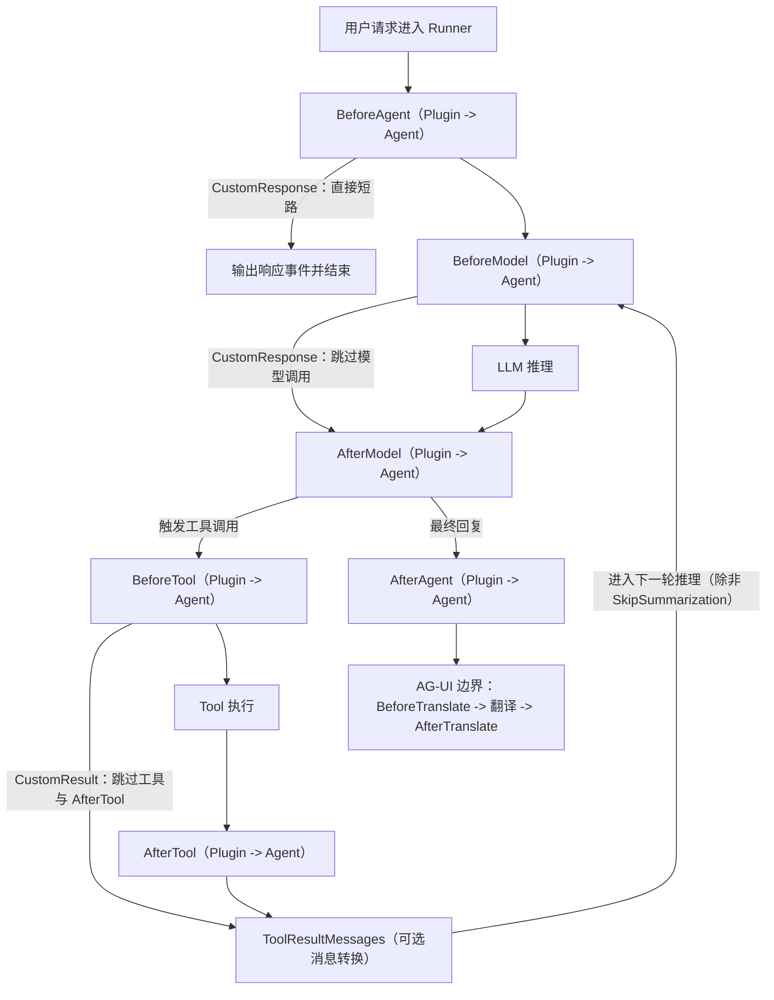
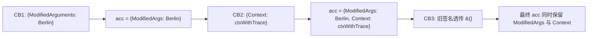

# 回调（Callbacks）

回调（Callbacks）允许你在 Agent 运行、模型推理、工具调用以及 AG-UI 事件翻译的关键生命周期节点上，以结构化方式进行**观测、改写、短路或中止**。

!!! tip "Callbacks 与 Plugins 的区别"
    - **Callbacks（回调）** 是 **Agent 局部配置**，通过 `llmagent.WithAgentCallbacks`、`WithModelCallbacks`、`WithToolCallbacks` 绑定到单个 Agent。
    - **Plugins（插件）** 是 **Runner 全局作用域**的回调打包机制，通过 `runner.WithPlugins(...)` 一次注册、全局生效。在每个 Hook 点上，**先执行插件的全局回调，再执行 Agent 的局部回调**。详见 [插件（Plugins）](./plugin.md)。

---

## 一眼看懂核心设计

理解整个回调系统，只需要抓住 **3 个核心心智模型**：

1. **在哪执行** —— 洋葱式生命周期与短路路径。
2. **能做什么** —— 结构化回调统一的 4 种返回意图。
3. **如何叠加** —— 2 个执行控制开关 + 1 套“只读稀疏补丁”结果累积模型。

### 1. 执行生命周期



### 2. 回调的 4 种标准意图

全部结构化回调（`Before/After` × `Agent/Model/Tool`）都通过 `(result, error)` 表达以下 4 种意图之一：

| 意图 | 返回值写法 | 默认链路行为 |
| --- | --- | --- |
| **观测 / 透传** | `nil, nil`（或空结构体 `&Result{}`） | 继续执行下一个回调 |
| **透传上下文 / 改写输入** | 设置 `Context`、`ModifiedArguments`，或原地修改 `args.Request` | 继续执行，并将字段向后累积 |
| **拦截短路 / 替换输出** | 设置非空 `CustomResponse` 或 `CustomResult` | 立即停止链路（除非开启 `WithContinueOnResponse(true)`） |
| **报错 / 终止运行** | 返回普通 `err` 或 `agent.NewStopError(...)` | 立即停止链路（除非开启 `WithContinueOnError(true)`） |

---

## 执行控制与多回调组合

全部 **6 条结构化回调链**（`BeforeAgent`、`AfterAgent`、`BeforeModel`、`AfterModel`、`BeforeTool`、`AfterTool`）共用完全一致的执行控制选项与结果累积语义。

!!! note "TranslateCallbacks 属于独立链路"
    用于 AG-UI 事件翻译的 `TranslateCallbacks` 不参与多回调结果累积，也不提供 `WithContinueOn*` 选项：一旦返回错误或非空自定义事件即立即停止。详见 [TranslateCallbacks](#translatecallbacks)。

### 执行控制选项

回调按注册顺序依次执行。默认情况下，一旦回调返回**错误**或非空的 **`CustomResponse`/`CustomResult`**，链路立即停止；仅设置 `Context`、`ModifiedArguments` 或 `SkipSummarization` 不会停止链路。

三类回调构造函数（`agent.NewCallbacks`、`model.NewCallbacks`、`tool.NewCallbacks`）提供相同的两个控制选项：

```go
callbacks := model.NewCallbacks(
    model.WithContinueOnError(true),    // 出错后继续执行，最终返回第一个错误
    model.WithContinueOnResponse(true), // 返回 CustomResponse/CustomResult 后继续执行，最后一个非空结果胜出
)
```

| 模式 | `ContinueOnError` | `ContinueOnResponse` | 行为 |
| --- | --- | --- | --- |
| **默认** | `false` | `false` | 遇到第一个错误或第一个 `CustomResponse`/`CustomResult` 时立即停止。 |
| **错误后继续** | `true` | `false` | 出错后继续执行（保留**第一个**错误）；遇到 `CustomResponse`/`CustomResult` 仍立即停止。 |
| **响应后继续** | `false` | `true` | 返回覆盖结果后继续执行（采用**最后一个**非空覆盖）；遇到错误仍立即停止。 |
| **两者皆继续** | `true` | `true` | 执行全部回调，最终同时返回已累积的结果与第一个错误（如有）。 |

如果单个回调同时返回了错误和自定义响应/结果，错误判断优先（在默认 `continueOnError == false` 时直接按错误停止）。

### 多回调结果累积（只读稀疏补丁模型）

除非因回调错误而默认早停，否则每次回调返回的非 `nil` 结果都会被视为一份**只读稀疏补丁（sparse patch）**，合并到框架自持的累积器中。后续回调返回 `nil`、空结构体 `&Result{}`、旧签名 `(nil, nil)` 透传，或只设置其他字段时，**不会抹掉**前面已累积的字段：



各字段严格遵循 3 类合并规则：

| 合并规则 | 适用字段 | 合并行为 |
| --- | --- | --- |
| **独立覆盖（最近非空胜出）** | `Context`（全 6 条链）<br>`ModifiedArguments`（`BeforeTool`） | 保留最近一次非空值，并同步传给后续回调（更新 `ctx` / `args.Arguments`）。建议从回调输入的 `ctx` 派生新上下文以保留取消传播、截止时间和值；`context.Background()` 或 `context.WithoutCancel(ctx)` 会主动解除取消传播。 |
| **成组覆盖（绑定为整体）** | `CustomResponse`（`Agent`/`Model`）<br>`CustomResult` + `SkipStateDelta`（`BeforeTool`）<br>`CustomResult` + `SkipResultFormatter` + `SkipStateDelta`（`AfterTool`） | **仅当**后续回调返回非空 `CustomResponse` 或 `CustomResult` 时整组替换。在 `WithContinueOnResponse(true)` 下，返回空结构体或旧签名透传不会清空前序覆盖及其配套标志。 |
| **单调累加（逻辑 OR）** | `SkipSummarization`（`AfterTool`） | 跨回调按逻辑或（OR）累积，遇到 `CustomResult` 早停时同样生效。 |

关于结构体所有权隔离、错误早停返回边界以及并行工具结果发布等底层契约，见 [进阶契约与边界说明](#advanced-contracts)。

---

## 各阶段回调参考

以下各节均遵循上述统一的控制流与累积模型，仅列出该阶段独有的参数结构、字段说明与接入方式（按洋葱生命周期由外向内排列）。

### AgentCallbacks

在整次 Agent 执行开始前与产出最终响应事件后触发。

```go
type BeforeAgentArgs struct {
    Invocation *agent.Invocation // 调用上下文
}

type BeforeAgentResult struct {
    Context        context.Context // 可选，替换后续操作使用的上下文
    CustomResponse *model.Response // 非空时跳过 Agent 执行并直接返回此响应
}

type AfterAgentArgs struct {
    Invocation        *agent.Invocation // 调用上下文
    FullResponseEvent *event.Event      // Agent 执行产出的最终响应事件（可能为 nil）
    Error             error             // Agent 执行过程中发生的错误（可能为 nil）
}

type AfterAgentResult struct {
    Context        context.Context // 可选，替换后续操作使用的上下文
    CustomResponse *model.Response // 非空时替换原始响应
}

type BeforeAgentCallbackStructured func(ctx context.Context, args *agent.BeforeAgentArgs) (*agent.BeforeAgentResult, error)
type AfterAgentCallbackStructured  func(ctx context.Context, args *agent.AfterAgentArgs) (*agent.AfterAgentResult, error)
```

**阶段要点：**

- `BeforeAgent` 可直接访问 `args.Invocation`，适合做入口鉴权、配额校验或短路返回固定响应。
- `AfterAgent` 通过 `args.FullResponseEvent` 获取最终输出事件，适合审计、后处理或响应替换。

**示例与绑定：**

```go
agentCallbacks := agent.NewCallbacks().
    RegisterBeforeAgent(func(ctx context.Context, args *agent.BeforeAgentArgs) (*agent.BeforeAgentResult, error) {
        if args.Invocation != nil && strings.Contains(args.Invocation.GetUserMessageContent(), "/abort") {
            return &agent.BeforeAgentResult{
                CustomResponse: &model.Response{
                    Choices: []model.Choice{{Message: model.Message{Role: model.RoleAssistant, Content: "aborted by callback"}}},
                },
            }, nil
        }
        return nil, nil
    }).
    RegisterAfterAgent(func(ctx context.Context, args *agent.AfterAgentArgs) (*agent.AfterAgentResult, error) {
        if args.Error != nil {
            return nil, args.Error
        }
        if args.FullResponseEvent != nil && args.FullResponseEvent.Response != nil && len(args.FullResponseEvent.Response.Choices) > 0 {
            c := args.FullResponseEvent.Response.Choices[0]
            c.Message.Content += "\n\n-- handled by agent callback"
            args.FullResponseEvent.Response.Choices[0] = c
            return &agent.AfterAgentResult{CustomResponse: args.FullResponseEvent.Response}, nil
        }
        return nil, nil
    })

llmAgent := llmagent.New(
    "chat-assistant",
    llmagent.WithModel(modelInstance),
    llmagent.WithAgentCallbacks(agentCallbacks),
)
```

---

### ModelCallbacks

在每次 LLM 推理请求发送前与收到响应后触发。

```go
type BeforeModelArgs struct {
    Request *model.Request // 即将发送给模型的请求（可原地修改）
}

type BeforeModelResult struct {
    Context        context.Context // 可选，替换后续操作使用的上下文
    CustomResponse *model.Response // 非空时跳过真实模型调用并返回此响应
}

type AfterModelArgs struct {
    Request  *model.Request  // 发送给模型的原始请求
    Response *model.Response // 模型返回的响应（可能为 nil）
    Error    error           // 模型调用过程中发生的错误（可能为 nil）
}

type AfterModelResult struct {
    Context        context.Context // 可选，替换后续操作使用的上下文
    CustomResponse *model.Response // 非空时替换原始模型响应
}

type BeforeModelCallbackStructured func(ctx context.Context, args *model.BeforeModelArgs) (*model.BeforeModelResult, error)
type AfterModelCallbackStructured  func(ctx context.Context, args *model.AfterModelArgs) (*model.AfterModelResult, error)
```

**阶段要点：**

- `BeforeModel` 可原地改写 `args.Request`（如动态注入消息、改写参数），也可返回 `CustomResponse` 跳过真实推理（如缓存命中、命令拦截）。
- `AfterModel` 同时提供原始 `args.Request` 与 `args.Response`，便于脱敏还原、内容风控与响应重写。

**示例与绑定：**

```go
modelCallbacks := model.NewCallbacks().
    RegisterBeforeModel(func(ctx context.Context, args *model.BeforeModelArgs) (*model.BeforeModelResult, error) {
        if len(args.Request.Messages) > 0 && strings.Contains(args.Request.Messages[len(args.Request.Messages)-1].Content, "/ping") {
            return &model.BeforeModelResult{
                CustomResponse: &model.Response{
                    Choices: []model.Choice{{Message: model.Message{Role: model.RoleAssistant, Content: "pong"}}},
                },
            }, nil
        }
        return nil, nil
    }).
    RegisterAfterModel(func(ctx context.Context, args *model.AfterModelArgs) (*model.AfterModelResult, error) {
        if args.Error != nil {
            return nil, args.Error
        }
        if args.Response != nil && len(args.Response.Choices) > 0 {
            args.Response.Choices[0].Message.Content += "\n\n-- answered by callback"
            return &model.AfterModelResult{CustomResponse: args.Response}, nil
        }
        return nil, nil
    })

llmAgent := llmagent.New(
    "chat-assistant",
    llmagent.WithModel(modelInstance),
    llmagent.WithModelCallbacks(modelCallbacks),
)
```

---

### ToolCallbacks

在每次工具调用前、调用后，以及将工具结果转换为回传模型的消息时触发。

```go
type BeforeToolArgs struct {
    ToolCallID  string            // 模型发出的工具调用 ID
    ToolName    string            // 工具名称
    Declaration *tool.Declaration // 工具声明元数据
    Arguments   []byte            // 当前 JSON 参数
    ResumeValue any               // 恢复值（中断恢复场景）
    ResumeMap   map[string]any    // 恢复值映射
}

type BeforeToolResult struct {
    Context           context.Context // 可选，替换后续操作使用的上下文
    CustomResult      any             // 非空时跳过工具执行并直接返回此结果
    SkipStateDelta    bool            // 跳过 CustomResult 的 state-delta provider（CustomResult 为 nil 时忽略）
    ModifiedArguments []byte          // 非空时使用修改后的参数执行工具
}

type AfterToolArgs struct {
    ToolCallID  string            // 模型发出的工具调用 ID
    ToolName    string            // 工具名称
    Declaration *tool.Declaration // 工具声明元数据
    Arguments   []byte            // before-tool 回调后的最终 JSON 参数
    Result      any               // 工具执行结果（可能为 nil）
    Error       error             // 工具执行错误（可能为 nil）
    Meta        map[string]any    // 可选元数据（例如 MCP CallToolResult 的 _meta）
}

type AfterToolResult struct {
    Context             context.Context // 可选，替换后续操作使用的上下文
    CustomResult        any             // 非空时替换原始结果
    SkipResultFormatter bool            // 对 CustomResult 跳过工具 result formatter（CustomResult 为 nil 时忽略）
    SkipStateDelta      bool            // 跳过 CustomResult 的 state-delta provider（CustomResult 为 nil 时忽略）
    SkipSummarization   bool            // 为 true 时在 tool.response 后结束本轮
}

type BeforeToolCallbackStructured func(ctx context.Context, args *tool.BeforeToolArgs) (*tool.BeforeToolResult, error)
type AfterToolCallbackStructured  func(ctx context.Context, args *tool.AfterToolArgs) (*tool.AfterToolResult, error)
```

**阶段要点：**

- **修改参数**：要让工具真正使用新参数，必须返回 `BeforeToolResult.ModifiedArguments`（框架会同步用于工具执行、`TraceToolCall` 可观测属性以及图事件 `emitToolStartEvent`/`emitToolCompleteEvent`）。仅修改 `args.Arguments` 只影响同一回调链中的后续回调。
- **结果处理标志（`SkipResultFormatter`、`SkipStateDelta`）**：均依附于非空 `CustomResult`，当 `CustomResult == nil` 时会被忽略：
  - `SkipResultFormatter`：绕过工具自身的 result formatter，改用默认转换（`model.ToolResultContent` 保留结构化内容，其余按 JSON 序列化），适用于返回协议或错误信封而非工具声明输出类型的场景。
  - `SkipStateDelta`：阻止非空 `CustomResult` 触发工具的 state-delta provider，适用于替换结果并非工具成功输出的场景。
- **跳过总结（`SkipSummarization`）**：在 `tool.response` 后直接结束本轮，跳过额外的总结型 LLM 调用；它**不会**把 `tool.response` 变成最终 assistant 消息，消费侧仍应以 `runner.completion`（`event.IsRunnerCompletion()`）作为真正的终止信号。

!!! warning "工具鉴权与 Session 历史"
    `BeforeTool` 仅在模型**实际发起工具调用**时触发。如果工具结果写入了 Session 历史且同一会话内权限可能变化，模型可能直接复用历史答案而跳过工具调用。此类场景需在 Prompt 构建阶段同步做好历史隔离或过滤（参考 Session 文档「权限变更与历史隔离」）。

**示例与绑定：**

```go
toolCallbacks := tool.NewCallbacks().
    RegisterBeforeTool(func(ctx context.Context, args *tool.BeforeToolArgs) (*tool.BeforeToolResult, error) {
        if args.Arguments != nil && args.ToolName == "calculator" {
            var payload map[string]any
            if err := json.Unmarshal(args.Arguments, &payload); err != nil {
                return nil, err
            }
            if op, ok := payload["operation"].(string); ok {
                payload["operation"] = strings.ToLower(op)
            }
            modifiedJSON, err := json.Marshal(payload)
            if err != nil {
                return nil, err
            }
            return &tool.BeforeToolResult{ModifiedArguments: modifiedJSON}, nil
        }
        return nil, nil
    }).
    RegisterAfterTool(func(ctx context.Context, args *tool.AfterToolArgs) (*tool.AfterToolResult, error) {
        if args.Error != nil {
            return nil, args.Error
        }
        if s, ok := args.Result.(string); ok {
            return &tool.AfterToolResult{
                CustomResult: s + "\n-- post processed by tool callback",
            }, nil
        }
        return nil, nil
    })

llmAgent := llmagent.New(
    "chat-assistant",
    llmagent.WithModel(modelInstance),
    llmagent.WithTools(tools),
    llmagent.WithToolCallbacks(toolCallbacks),
)
```

动态跳过总结示例：

```go
toolCallbacks.RegisterAfterTool(func(ctx context.Context, args *tool.AfterToolArgs) (*tool.AfterToolResult, error) {
    if args.Error != nil {
        return nil, nil
    }
    if out, ok := args.Result.(map[string]any); ok && out["action"] != nil {
        return &tool.AfterToolResult{SkipSummarization: true}, nil
    }
    return nil, nil
})
```

#### ToolResultMessages 回调

`ToolResultMessagesFunc` 在工具执行与 `AfterTool` 之后触发一次，用于自定义工具结果如何转为发回模型的消息：

```go
type ToolResultMessagesInput struct {
    ToolName           string            // 工具名称
    Declaration        *tool.Declaration // 工具声明
    Arguments          []byte            // 最终 JSON 参数（经过 before-tool 回调）
    Result             any               // 最终工具结果（经过 after-tool 回调）
    ToolCallID         string            // 工具调用 ID
    DefaultToolMessage any               // 框架默认会发送的工具响应消息
}

type ToolResultMessagesFunc = func(ctx context.Context, in *tool.ToolResultMessagesInput) (any, error)
```

- 返回 `(nil, nil)` 或空切片时，回退使用 `DefaultToolMessage`。
- 返回非空消息时替换默认消息；配合 `llmagent` 内置 OpenAI/Anthropic 适配器使用时，推荐返回 `[]model.Message`，且至少包含一条 `Role: model.RoleTool`、`ToolID: in.ToolCallID` 的消息。

```go
toolCallbacks := tool.NewCallbacks().
    RegisterToolResultMessages(func(ctx context.Context, in *tool.ToolResultMessagesInput) (any, error) {
        if messages, ok := in.Result.([]string); ok {
            return []model.Message{
                {
                    Role:    model.RoleTool,
                    Content: "工具结果：" + strings.Join(messages, ", "),
                    ToolID:  in.ToolCallID,
                },
            }, nil
        }
        return nil, nil
    })
```

---

### TranslateCallbacks

`TranslateCallbacks` 用于 AG-UI 事件翻译边界：在内部事件翻译为 AG-UI 事件前（`BeforeTranslate`）以及发往客户端前（`AfterTranslate`）触发。

```go
import (
    aguievents "github.com/ag-ui-protocol/ag-ui/sdks/community/go/pkg/core/events"
    "trpc.group/trpc-go/trpc-agent-go/event"
    "trpc.group/trpc-go/trpc-agent-go/server/agui/translator"
)

type BeforeTranslateCallback func(ctx context.Context, evt *event.Event) (*event.Event, error)
type AfterTranslateCallback  func(ctx context.Context, evt aguievents.Event) (aguievents.Event, error)
```

- 返回非空自定义事件时，替换翻译输入（`Before`）或翻译输出（`After`）。
- **仅支持短路**：遇到错误或第一个非空自定义事件即立即停止，不提供 `WithContinueOn*` 选项；如需叠加多项修改，请在单个回调中完成。

```go
translateCallbacks := translator.NewCallbacks().
    RegisterBeforeTranslate(func(ctx context.Context, evt *event.Event) (*event.Event, error) {
        fmt.Println(evt)
        return nil, nil
    }).
    RegisterAfterTranslate(func(ctx context.Context, evt aguievents.Event) (aguievents.Event, error) {
        fmt.Println(evt)
        return nil, nil
    })
```

更多细节参见 [AG-UI](./agui/index.md)。

---

## 常见实战模式

### 在回调中停止 Agent

当需要因配额校验、风控拦截或人工中断而终止执行时，在回调中返回 `agent.NewStopError`。Flow 会将其转为 `stop_agent_error` 事件（消费侧可通过 `event.Error.Type == agent.ErrorTypeStopAgentError` 识别）并停止循环：

```go
agentCallbacks := agent.NewCallbacks().
    RegisterBeforeAgent(func(ctx context.Context, args *agent.BeforeAgentArgs) (*agent.BeforeAgentResult, error) {
        if args.Invocation != nil && args.Invocation.TokenUsage.Total >= maxTokens {
            return nil, agent.NewStopError("token limit reached")
        }
        return nil, nil
    }).
    RegisterAfterAgent(func(ctx context.Context, args *agent.AfterAgentArgs) (*agent.AfterAgentResult, error) {
        if args.Error != nil {
            return nil, args.Error
        }
        if args.FullResponseEvent != nil && args.FullResponseEvent.Response != nil &&
            args.FullResponseEvent.Response.Usage.TotalTokens >= maxTokens {
            return nil, agent.NewStopError("token limit reached after response")
        }
        return nil, nil
    })
```

若还需要对正在进行的模型或工具调用做硬截止，请配合 `context` 取消使用（见 Runner 文档的中断说明）。

### 访问 Invocation 与 Tool Call ID

任意回调均可通过 `ctx` 获取当前 `Invocation`：

```go
if inv, ok := agent.InvocationFromContext(ctx); ok && inv != nil {
    fmt.Printf("invocation id=%s, agent=%s\n", inv.InvocationID, inv.AgentName)
}
```

在工具回调中，可直接读取 `args.ToolCallID`，也可通过 `tool.ToolCallIDFromContext(ctx)` 从 `ctx` 获取。

### Invocation State：在回调间共享状态

`Invocation` 提供线程安全、懒初始化、按单次调用隔离的键值存储，用于在 `Before`/`After` 回调及中间件间传递状态：

```go
func (inv *Invocation) SetState(key string, value any)
func (inv *Invocation) GetState(key string) (any, bool)
func (inv *Invocation) DeleteState(key string)
```

**推荐键名规范**（避免键冲突，尤其是并发工具调用场景）：

| 作用域 | 键名格式 | 示例 |
| --- | --- | --- |
| Agent 回调 | `"agent:<key>"` | `"agent:start_time"` |
| Model 回调 | `"model:<key>"` | `"model:start_time"` |
| Tool 回调（并发安全） | `"tool:<toolName>:<toolCallID>:<key>"` | `"tool:calculator:call_abc123:start_time"` |
| 中间件 / 自定义逻辑 | `"middleware:<key>"` / `"custom:<key>"` | `"middleware:request_id"` |

**示例：支持并发的 Tool 回调计时**（Agent 与 Model 计时写法相同，只需改用 `"agent:..."` 或 `"model:..."` 键名）：

```go
toolCallbacks := tool.NewCallbacks().
    RegisterBeforeTool(func(ctx context.Context, args *tool.BeforeToolArgs) (*tool.BeforeToolResult, error) {
        toolCallID := args.ToolCallID
        if toolCallID == "" {
            toolCallID = "default"
        }
        key := fmt.Sprintf("tool:%s:%s:start_time", args.ToolName, toolCallID)
        if inv, ok := agent.InvocationFromContext(ctx); ok && inv != nil {
            inv.SetState(key, time.Now())
        }
        return nil, nil
    }).
    RegisterAfterTool(func(ctx context.Context, args *tool.AfterToolArgs) (*tool.AfterToolResult, error) {
        toolCallID := args.ToolCallID
        if toolCallID == "" {
            toolCallID = "default"
        }
        key := fmt.Sprintf("tool:%s:%s:start_time", args.ToolName, toolCallID)
        if inv, ok := agent.InvocationFromContext(ctx); ok && inv != nil {
            if startVal, ok := inv.GetState(key); ok {
                fmt.Printf("Tool %s (call %s) took: %v\n", args.ToolName, toolCallID, time.Since(startVal.(time.Time)))
                inv.DeleteState(key) // 用完清理，避免内存泄漏
            }
        }
        return nil, nil
    })
```

完整可运行实战示例：

- 计时与 OpenTelemetry 集成：[examples/callbacks/timer](https://github.com/trpc-group/trpc-agent-go/tree/main/examples/callbacks/timer)
- 基于 Invocation State 的鉴权与审计日志：[examples/callbacks/auth](https://github.com/trpc-group/trpc-agent-go/tree/main/examples/callbacks/auth)

### Mock 短路与可复用链式注册

在测试或降级场景中，通过 `BeforeTool` 直接返回 Mock 结果并跳过真实工具执行：

```go
toolCallbacks := tool.NewCallbacks().
    RegisterBeforeTool(func(ctx context.Context, args *tool.BeforeToolArgs) (*tool.BeforeToolResult, error) {
        if args.ToolName == "calculator" && args.Arguments != nil && strings.Contains(string(args.Arguments), "42") {
            return &tool.BeforeToolResult{
                CustomResult: calculatorResult{Operation: "custom", A: 42, B: 42, Result: 4242},
            }, nil
        }
        return nil, nil
    })
```

所有 `Register*` 方法均返回接收者本身，支持链式构造可复用的回调集合（`NewCallbacks().RegisterBefore*(...).RegisterAfter*(...)`）；如果需要跨所有 Agent 统一生效，建议打包为 [插件（Plugin）](./plugin.md)。

---

## 进阶契约与边界说明（Advanced Contracts）

以下底层契约适用于全部 6 条结构化回调链（`Before/After` × `Agent/Model/Tool`）：

- **所有权与隔离**：框架在调用下一个回调前，会将已采纳结果的顶层字段复制到独立累积器中，**绝不就地修改**回调方持有的结果结构体（包括 `agent` 保留 graph completion capture 标记的场景）。因此回调方复用或清空结构体不会抹掉已累积字段；但其中引用的响应对象（`*model.Response`）与参数缓冲区（`[]byte`）仍共享引用，不做深拷贝。
- **错误早停返回边界**：
  - 默认遇到错误停止（`continueOnError == false`）时：`Agent` 与 `Model` 回调链返回 `(nil, err)`；`Tool` 回调链返回出错回调的原始 `(result, err)`，不合并先前字段。
  - 启用 `WithContinueOnError(true)` 后：6 条链均返回已累积结果与第一个错误。
- **并行工具结果发布**：并行工具在默认合并结果模式下，回调替换后的 `Context` 用于控制工具执行，而结果发布遵循 worker 生命周期——仅取消回调替换的上下文不会丢弃缓存结果，主动解除取消传播（`context.Background()` / `context.WithoutCancel(ctx)`）也不会让结果发布在 worker 取消后继续阻塞等待。
- **旧签名回调兼容**：已废弃的旧签名回调仍可通过自动包装器注册。当旧回调返回 `(nil, nil)` 时，包装器返回空结构体，在新的稀疏补丁累积模型下作为透传处理，不会清空前序已累积的字段（包括 `WithContinueOnResponse(true)` 下的前序覆盖）。

---

## 运行完整示例

以上核心用法均可在 [`examples/callbacks/main.go`](https://github.com/trpc-group/trpc-agent-go/tree/main/examples/callbacks/main.go) 中直接运行观察：

```bash
cd examples/callbacks
export OPENAI_API_KEY="your-api-key"

# 基本运行
go run .

# 指定模型
go run . -model gpt-4o-mini

# 关闭流式
go run . -streaming=false
```

运行后可在日志中观察 Before/After 回调执行、参数修改与工具返回结果。
